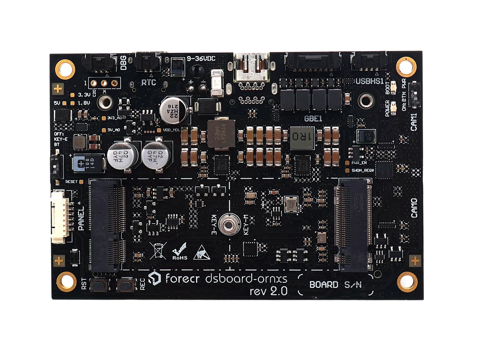
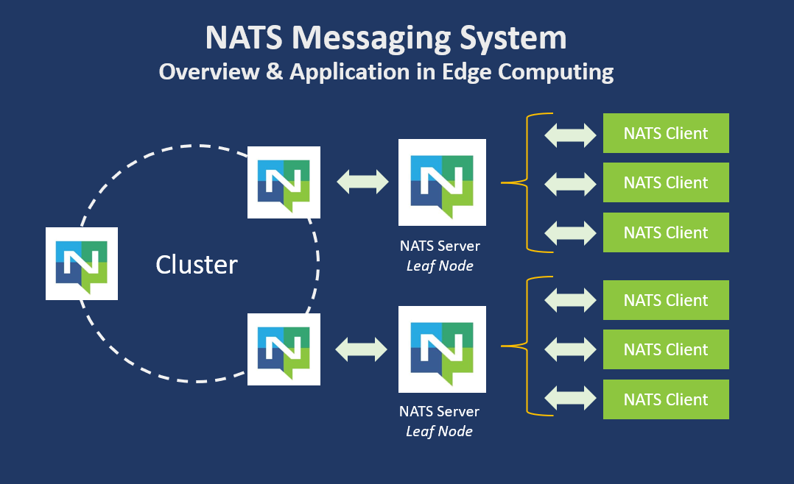
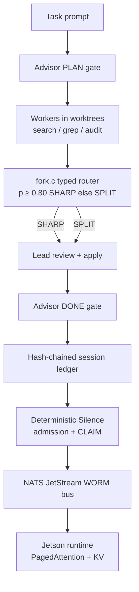

# muse-swarm

[](LICENSE)
[](Makefile)
[](runtime/)
[](bus/)
[](worm/)
[]()

A four-seat agent swarm that runs on endpoints the operator owns: an advisor, a lead, a typed-decision fork layer, and a worker swarm, with every step written to a hash-chained session ledger. It is the swarm shape the metered tools sell — advisor, lead, subagent swarm, decision router — rebuilt Ollama-and-Meta style: local models by default, Meta models in any seat by configuration, no seat rented from Anthropic.


The November 2026 additions bring Deterministic Silence admission, a zero-dependency Jetson runtime (PagedAttention, NATS client, KV policy), and a verified WORM ledger bus (Erlang supervision + Lean 4 transition predicate + C-node cross-checks).



## The seats

| Seat | Role | Default model | Card |
| --- | --- | --- | --- |
| advisor | reads the whole session; speaks only at the PLAN and DONE gates; never writes code | `nemotron-super` | `roles/advisor.txt` |
| lead | decomposes the task, applies verdicts, edits, runs tests, verifies | `llama3.2` | `roles/lead.txt` |
| workers | search (map the repo), grep (find call sites), audit (run the checks) — each in its own git worktree, each scoring its own proposal | `llama3.2:3b` | `roles/search.txt`, `roles/grep.txt`, `roles/audit.txt` |
| fork | typed-decision layer in C (`fork.c`): a worker proposal at p ≥ 0.80 is SHARP and runs in code; below that it is SPLIT and escalates to the lead | — | — |

The fork is the abstain rule of the typed-decision engine as a router: a decision the swarm is sure of is a verdict, and a decision it is split on is a proposal to the lead, never a coin flip.

The role cards are persona hooks in the Ghost Mesh sense: the seat lives in the card, not in the weights. Drop a different model into a seat and the seat behaves the same, because the card, the ledger, and the verdict rules are the connectome.

## Endpoints

Every seat is an OpenAI-shaped chat endpoint plus a model name:

```
ADVISOR_BASE / ADVISOR_MODEL     LEAD_BASE / LEAD_MODEL
WORKER_BASE  / WORKER_MODEL      *_API_KEY (optional, per seat)
```

The default base for every seat is Ollama at `http://localhost:11434/v1`. Setting a seat's base and model to a Meta endpoint puts a Muse in that seat; its `*_API_KEY` is read from the environment at call time and is never written to the ledger or to disk.

## Deterministic Silence (admission)

Bidding for a `.mkr` ticket is not a synchronous shout. Every node runs the Soufflé admission rules locally (`admission/admission.dl`): a hard filter on VRAM and load, a fitness score, and a bid gate at fitness > 10. A node that passes maps the XOR distance between the task's WORM seal and its own node id to a backoff delay — the closest node claims first, the rest stay silent. The executable form of the rules is `runtime/src/silence.rs`; the claim itself is an atomic compare-and-swap in the Erlang lock server, where a competing claim wins only at strictly lower Frustration Hamiltonian energy. NATS subjects are partitioned by task type (`mkr.ticket.synthesis`, `mkr.ticket.critique`), and a node subscribes only to its pinned role.

## The runtime (`runtime/`)

Zero-dependency Rust for the Jetson nodes:

- Lock-free PagedAttention block table over a static VRAM arena (65,536 blocks of 16 tokens).
- Zero-copy FFI seam to the CUDA paged-attention kernel (pinned, memory-mapped on the Orin's shared LPDDR5; `--features jetson`).
- KV cache policy with the K cache pinned to q8_0 for verification work and two-phase pruning — blocks are freed only after the ledger accepts the summary.
- Synchronous, stack-buffered NATS client that appends WORM blocks under the `Nats-Expected-Last-Sequence` gate and traps a wrong-sequence `-ERR` as the eviction signal.



## The WORM ledger bus (`bus/`, `worm/`)

The ledger is a verified state machine, not a passive log.

- JetStream stream config (`bus/SOVEREIGN_LEDGER.stream.json`) is append-only at the server level (`deny_delete`, `deny_purge`); appends carry the expected-last-sequence header so a beaten append is rejected at the network layer.
- Erlang supervision tree (rest-for-one root, connection manager with exponential backoff, dynamic consumer supervisor) runs one ledger worker per stream: each proposed block is verified — sequence gate, chain link, seal, Ed25519 signature — and an invalid block crashes the worker on purpose, so the supervisor restarts it purged.
- The transition itself is formalized in Lean 4 (`worm/Transition.lean`: admissibility, determinism, append-only prefix preservation), compiled to a C export, and served by a Lean verifier C node (`bus/cnode/lean_verifier_node.c`) that Erlang calls over distribution.
- A second C node cross-checks seals; a custom shell (`bus/worm_shell.erl`) inspects tails, verifies the sealed chain from disk, and compares local and C-node seals.

## Benchmarks and verification

| Component | Result | Notes |
| --- | --- | --- |
| `make test` (orchestrator + fork) | 18/18 pass | Original 12 unchanged; fork vectors + full dry-run flow + ledger recompute |
| Runtime crate (`runtime/`) | 23 cargo tests | SHA-256 FIPS vectors, block table, WORM seal match across Rust/Erlang/C, NATS HPUB frame, KV two-phase prune |
| Erlang bus (`bus/`) | 21 checks | Supervision boot, sequence gate, invalid block crashes worker (chain does not move), CLAIM lock energy rules, subject partitioning |
| Lean verifier node | Admissible / forked / energy-ceiling | `worm/Transition.lean` proofs check; C node answers over Erlang distribution |
| Seal cross-check | Identical on fixture | Shared fixture seal equals across Rust, Erlang, C seal node, and independent SHA-256 |
| Preprompt evidence | 4/4 role-card runs | Gemma-2-2b-it and Hermes-3-Llama-3.2-3B: bare fails, book-wearing emits exact fork decision block |

Full transcripts and method: `evidence/preprompt-demo/RESULTS.md`. Live model calls and the CUDA path are configuration on the operator's Jetson; the dry-run and host-fallback surfaces are what this tree verifies.

## Running it

```sh
make            # builds the fork router
make test       # router vectors + a full dry-run of the flow
./swarm.sh run "the task" [repo-dir]
./swarm.sh verify [repo-dir]
```

`run` executes the flow in a git repository: advisor PLAN gate, three workers in fresh worktrees, fork verdicts over their scored proposals, the lead's review, and the advisor DONE gate over the full ledger. State lands in `<repo>/.swarm/`; `verify` recomputes the ledger's hash chain. `SWARM_DRYRUN=1` runs the identical flow on the canned replies in `tests/fixtures/`.

## Architecture



## Repository layout

```
.
├── admission/          # Soufflé admission rules + silence.rs mirror
├── assets/             # hardware and bus photos
├── bus/                # Erlang supervision, C nodes, stream configs
├── evidence/           # preprompt-demo transcripts
├── fork.c              # typed-decision router
├── roles/              # seat persona cards
├── runtime/            # zero-dependency Jetson runtime
├── swarm.sh            # orchestrator
├── tests/              # fixtures + run-tests.sh
├── tools/jlens/        # jlens intake
├── worm/               # Lean 4 transition
└── README.md
```

## Status and limits

See [STATUS.md](STATUS.md) for verified claims (2026-11-06 orchestrator, 2026-11-07 silence/runtime/bus) and known limits (no live NATS server on the verification machine, CUDA path uncompiled here, Soufflé not installed, one task per run).

## License

SNAPKITTY OPAQUE SOURCE LICENSE v1.0 — see `LICENSE`.

---

**SnapKitty Research Lab** · Bel esprit D'accord Trust

The swarm the metered tools sell, rebuilt on owned endpoints and a verified ledger.
